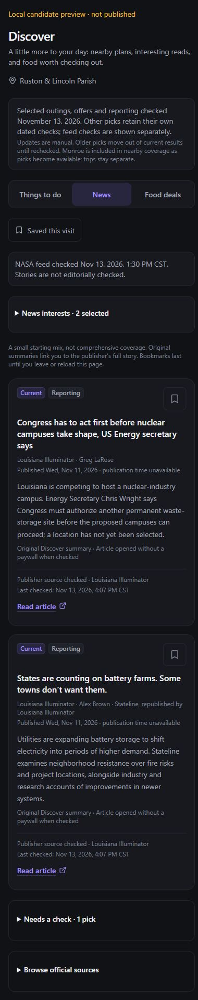
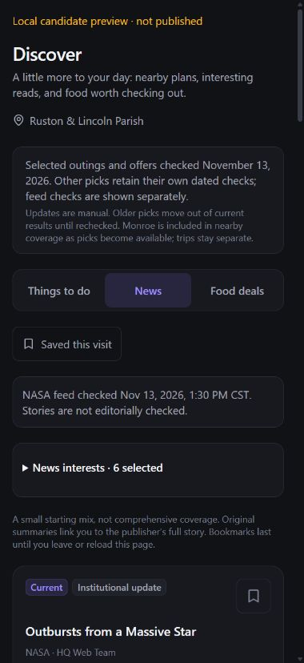

# Discover local candidate — November 13, 2026

**Latest:** [curated candidate integrated into the local app route](DISCOVER_LOCAL_INTEGRATION.md).
That route keeps NASA disabled; the earlier preview described below remains a
separate review surface with the saved NASA supplement. Nothing is deployed.

Prepared under the owner's instruction to continue from the
[capture/recovery handoff](DISCOVER_CAPTURE_RECOVERY.md). Local Git HEAD remains
`8d4a84d`; prior uncommitted work is preserved and privacy stays paused.

The next-step [app integration proposal and offline audit](DISCOVER_APP_INTEGRATION_PROPOSAL.md)
is complete. It specifies the local wiring, artifact packaging, timed stale/fallback
behavior and paused-work boundary. The next bounded task is implementing curated
candidate wiring and note forwarding locally, with feed selection still null.

## Reporting refresh — November 13, 4:07 PM Central

The next bounded content task is complete locally. Two existing publisher stories
were inspected again at `2026-11-13T22:07:54Z`: the
[Louisiana nuclear-campus report](https://lailluminator.com/2026/11/11/congress-nuclear/)
and the [battery-storage report](https://lailluminator.com/2026/11/11/repub/battery-farms/).
Their candidate records now contain newly written original factual summaries,
publisher/byline attribution and reporting labels. Stateline's authorship and the
Illuminator's republication are explicit. Both full pages were readable without a
paywall during inspection. Neither is a newly published November 13 story: both
retain November 11 publication dates. Visible time-of-day values lack a verified
zone, so precise publication instants remain unavailable.

Only those two editorial checks changed. The older computer story returned 403;
it remains stale with its old summary/check, rather than being renewed from a
search excerpt. A potential additional national story was inaccessible and was
not added. This is still a narrow reporting mix from one publisher/network, with
no new independent world-news source or comprehensive coverage claim.

The official [Wendy's offer page](https://www.wendys.com/offers-coupons) was inspected
again, but it did not resolve full redemption limits or Ruston participation.
No food record/check timestamp was advanced and neither review-only offer became
active. No app/account access or restaurant contact was attempted.

`candidate-news.ts` holds the two explicit overrides; `candidate.ts` replaces by
stable ID rather than appending duplicate stories. The preview compiler includes
that module. The default `curated.ts`, published feed selection, NASA artifact and
all of their timestamps remain unchanged. NASA still shows its actual **1:30 PM
Central** feed check. At this inspection the preview had 12 current news items
(10 institutional feed items and two reporting items), with three older editorial
items outside current results. Existing publication-date ordering is preserved:
the newer NASA items appear before the November 11 reporting in the full mix.
Choosing Louisiana/local and Technology demonstrates the two reporting cards.

**Validation:** 328 Discover tests across 13 suites, project TypeScript, changed-file
ESLint and whitespace checks passed. The added test verifies selective refresh,
unchanged publication metadata/attribution, stale exclusion after 24 hours, and
continued exclusion of the inaccessible story. The actual localhost preview showed
both reporting cards with original summaries, direct links, November 11 publication
dates and November 13 checks. At 390px/320px, document/available widths matched
380px/310px; no horizontal overflow or browser warnings/errors were observed.
The viewport override was reset and the preview tab retained. No full production
build, authenticated route or physical-device pass is inferred from this check.



**Scope:** `lib/discover/candidate-news.ts`, `candidate.ts`, `candidate.test.ts`,
`scripts/discover/preview-candidate.mjs`, this guide and the screenshot. No new
dependencies, source automation approvals, accounts, keys, requests to NASA,
schedulers or paid-service exposure. Publisher checks remain manual; the existing
24-hour editorial freshness rule still applies. Paused privacy/auth/store/journal
work was untouched. Nothing committed, pushed or deployed.

**Overview & Roadmap handoff:** the recommended first slice remains nearby outings,
clearly attributed reporting plus institutional science, and incomplete food offers
separated from active deals. Verified evidence and gaps are above; local food
participation, broader publisher coverage and ongoing curation ownership remain
unresolved. No free API quota or scraping permission is newly assumed. The next
bounded task is a local app-integration/release-scope proposal: inspect
`app/(app)/discover/page.tsx`, `lib/discover/feeds/published.ts` and the candidate
modules, identify the exact selection change and feed-artifact packaging, and
verify current freshness/fallback before any integration. Keep source acquisition
manual and paused-work overlaps excluded. Owner review of the candidate and a
maintenance owner/cadence are still needed; publication requires separate approval.

The remaining sections describe the earlier outing/offer preview checks; their
counts and next-task statements are historical where superseded above.

## Review the candidate

```sh
npm run discover:preview
```

The localhost-only preview is at [127.0.0.1:4323](http://127.0.0.1:4323/).
It is labeled **Local candidate preview · not published** and is separate from
the authenticated app and its current catalog. The working preview process/tab
were retained for review; stop the command with Ctrl+C when finished. It can be
restarted with the command above. No timer, feed request or publication follows.

`candidate.ts` contains a small editorial overlay: two rechecked existing outings,
five added outings and two restaurant-offer records (one refreshed, one added).
Older news retains its previous source/summary checks. A preview-only note explicitly
distinguishes these partial checks from a batch-wide refresh. The published route's
feed selection remains null; `curated.ts` and its timestamps are unchanged.

The preview separately validates the exact real NASA review bundle
`94bd1b2083a41695fe9b33f7cd4779647d13c0979147fb4acf31bd1c02f06bfb`
from the known ignored capture path. It never scans for a newer artifact, substitutes
a digest or fetches a missing file. The existing loader rejects altered/synthetic
content and falls back to the curated candidate if unavailable. Only mapped public
items, sources and availability reach the browser, not XML/snapshot/transport code.

NASA's actual check remains **November 13, 1:30 PM Central**. Preview/release time
cannot renew it; normal 24-hour staleness and seven-day publication expiry apply.
All 10 items were current under those rules during this check. Five older curated
stories were correctly outside current recommendations. This is institutional science
coverage, not a complete current local/technology/national/world reporting mix.

## Source review and uncertainties

Selected items were inspected at `2026-11-13T21:53:40Z` (3:53 PM Central).
Dates below use America/Chicago. These are official-source listing checks,
not organizer confirmations of no cancellation or guaranteed admission.

| Candidate | Source/evidence | Treatment |
| --- | --- | --- |
| Friday CedarTown market; Saturday children's activity | [Tourism calendar](https://www.rustonlincoln.com/events/holidays-in-cedartown-2/) | Friday price unknown. Saturday 9:30 AM–noon, $15 per child; adult price/ticket inventory unconfirmed. |
| Tonight's The Local performance | [Dated listing](https://www.rustonlincoln.com/events/the-local-live-music-henry-hood-viryln/) | 7–9 PM, 130 W Park Ave; price/admission restrictions unknown. |
| Tonight's Sundown performance | [Dated listing](https://www.rustonlincoln.com/events/sundown-live-music-kyle-thompson-band/) | 9 PM start; end/cover/age restrictions unconfirmed. No end inferred from a general weekly description. |
| Saturday farmers market | [Dated recurrence](https://www.rustonlincoln.com/events/ruston-farmers-market1-92/), [organizer hours](https://www.rustonfarmersmarket.org/snap-ebt) | November 14 is explicit; 9 AM–1 PM and address corroborated. Admission price remains unknown. |
| Free public campus exhibition | [Official calendar description](https://www.rustonlincoln.com/events/americans-and-the-holocaust/) | October 23–December 4 comes from the description; page heading is inconsistent. Daily library hours unknown; check before going. |
| Monday creative meetup | [Calendar](https://www.rustonlincoln.com/events/creative-meetups-81/), [organizer listings](https://creativeexchange.art/ce-events) | Calendar: 301 N Trenton; older organizer listings: 204 W Alabama. Unverified/review-only until resolved. |
| Wendy's offers | [Official offer page](https://www.wendys.com/offers-coupons) | November 15 app promotion verified; full terms/local participation unknown. Other combo dates unknown. Both review-only. |

The date-range exhibit now says **Within listed dates**, avoiding a claim that the
library is open right now. Its description preserves the unknown daily hours.
The start-only music event leaves current recommendations at its known start under
the existing conservative policy; it is not described as canceled or actually ended.
Completed lunchtime/preview events remain expired rather than receiving fresh checks.

Food research did **not** establish a confirmed Ruston offer. No app/account was
accessed, transaction begun or local participation inferred from a restaurant listing.
The undated combo's restaurant-purchase path follows the public no-offer-needed
advertising, but remains outside active deals. No unknown campaign dates were filled
in. Recurring offers without exact validity/complete terms were not promoted to active.
Popeyes terms were unreadable; Burger King's readable live page differed from indexed
terms, so neither supplied an active candidate. No expired or subscription-dependent
offer was used to fill the empty confirmed-nearby section.

This slice remains Ruston-focused. Nearby Monroe coverage, a freshly dated trivia
occurrence and major weekend-trip options are still gaps; general schedules and old
trivia occurrences were not expanded into invented future events.

## Checks and operational limits

- **327 Discover tests passed** across 13 suites, plus project TypeScript, changed-file
  ESLint and whitespace checks. Five new candidate tests cover validation, unchanged
  baseline/news checks, review-only uncertainties, expiry and date-range labeling.
- An isolated browser preview used the actual view, styles, candidate and saved real
  snapshot. No auth, app store, environment file or personal record was read. Vite's
  environment loading is explicitly disabled; server binds only to 127.0.0.1.
- The sandboxed server was unreachable from the in-app browser. Restarting the same
  localhost-only command outside the sandbox with approval resolved it. No firewall,
  network security or production setting was changed. The failed temporary tab was
  not retained; the working preview tab was marked as a deliverable.
- At 320px viewport: available/document width both **310px**; at 390px: both **380px**.
  All three tabs fit without horizontal overflow. Current main cards at inspection:
  six outings, ten NASA stories after pagination, zero confirmed-nearby deals.
- News pagination showed **4 → 8 → 10** main cards. Food's two records stayed under
  “Needs a check”; the disputed meetup stayed there too. The free filter showed the
  campus exhibit; under-$20 showed that exhibit and the children's event. Unknown
  prices were not treated as free. Working-tab browser logs had zero warnings/errors.
- Browser viewport override was reset. This is isolated in-app Chromium evidence,
  not authenticated app, physical iPhone, Safari or Home Screen acceptance. No full
  production build was rerun for this preview/content slice. Earlier isolated Next
  build evidence remains bounded; the full-app/device release gates stay open.



The command uses existing installed TypeScript/Vite/Tailwind development tooling;
there is no new package, account, key, paid service or hosting resource. Generated
modules, inert catalog JSON, CSS and cache remain ignored under
`build/discover-candidate-preview/`. This is a development review tool, not a runtime
ingestion service. Local files/digests provide controlled review, not authenticated
publisher provenance or durable shared refresh guarantees.

## Overview & Roadmap handoff

**Recommended MVP:** this candidate demonstrates useful outings and actual scrollable
science items while keeping incomplete deals clearly separated. It still needs broader
current reporting and confirmed offer terms/participation before claiming full coverage.

**Verified:** dated official listing metadata, recorded uncertainties, actual snapshot
integration in the isolated preview, tests and responsive checks above.
**Uncertain:** disputed venue, unknown admission/offer details, cancellations after
inspection, daily exhibit hours, broader coverage, ongoing curation/cadence, provider
quotas and physical-device/full-app acceptance. No automatic updates promised.

**Affected files:** new `lib/discover/candidate.ts` and focused tests, manual preview
command/package script, optional view note and date-range badge wording, this guide
and screenshot. No baseline catalog values, release selection, auth/store/journal/
privacy files, source approvals, database or hosting configuration changed. All prior
edits are preserved. Nothing committed, pushed or deployed; no NASA request this stage.

**Decisions for owner review:** whether these outings and institutional science/photo
items feel useful; whether to prioritize resolving local food offers or expanding
current Louisiana/national/technology reporting next. Free-only and city-level
preferences remain intact; no account access is needed for ordinary source research.

**Next bounded task:** refresh two or three Louisiana/technology/national stories from
publisher pages with dated original summaries, while retaining the real NASA clock
and source distinction. Resolve one food offer only if official public terms establish
the missing details; otherwise leave its uncertainty visible. Prepare exact local app
integration/release files for review after the candidate is assessed, keeping paused
work excluded and publication separately authorized.
