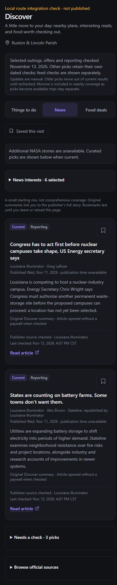

# Discover curated candidate integrated locally

**Latest:** the [saved NASA supplement is selected locally and release checks pass](DISCOVER_RELEASE_READINESS.md).
Historical curated-only/disabled-selection statements below describe the preceding
stage. No deployed app change is implied.

**Next-stage update:** [optional NASA artifact packaging is complete](DISCOVER_ARTIFACT_PACKAGING.md),
including identity, lifecycle, fallback and server/client-boundary checks. Feed
selection remains null. The concrete optional-selection diff is ready for review.

November 13, 2026. Implemented under the owner's instruction to continue from the
[integration proposal](DISCOVER_APP_INTEGRATION_PROPOSAL.md). Local HEAD remains
`8d4a84d`. Nothing was committed, pushed or deployed. All preexisting changes remain
preserved and privacy work remains paused.

## Result

The existing Discover page now selects the 16-record editorial candidate through
the server catalog entry. Both the loaded view and Suspense fallback receive the
candidate's partial-check note and matching editorial items. The view wrapper
forwards that note while retaining its historical label when used without a note.
The baseline `curated.ts` and all source/publication/summary dates are unchanged.

`publishedFeed` remains null. The route performs no feed request or runtime file,
environment, ledger or database read. The no-artifact branch still avoids runtime
clock/IO work; client lifecycle rules determine current visibility after hydration.
The optional artifact branch retains `await io()` before reading its validation
clock. No release artifact module was created or selected.

At browser inspection, the route showed six main outings, two main reporting
stories, and zero confirmed food deals. The conflicting meetup and both incomplete
offers remain under “Needs a check”; three old editorial news records remain there
as well. News explicitly says supplemental NASA stories are unavailable. This local
route differs from the earlier candidate preview, which includes the saved NASA
bundle for review. Neither review process changes the deployed application.

## Verification

- **329 Discover tests passed** across 13 suites. The server-entry expectation now
  checks exact candidate output with no fetch/runtime IO. A new wrapper test checks
  note forwarding before the client clock is ready, no premature “Happening now”
  claim, and retention of the historical label when the optional note is omitted.
  All existing loader, lifecycle, duplicate and uncertainty tests still pass.
- Project TypeScript and changed-file ESLint passed. Whitespace checks passed.
- An isolated Next.js 16.4.1 Webpack production build passed with Cache Components
  and Partial Prefetching enabled, importing the actual Discover page/server entry/
  wrapper. The first sandbox build failed creating a directory with `EPERM`; the
  approved outside-sandbox rerun completed compilation, TypeScript, static generation
  and build tracing. No permissions or security settings were changed.
- The fixture under ignored `build/discover-next-loader-check/` omits the shared
  authenticated layout, auth/store/personal data and font pipeline. It uses public
  Discover styles copied from the earlier compiled stylesheet. Its output is
  `.next-curated-integration`; the application's existing `.next` was not cleaned.
- Browser checks exercised the built Next route, rather than the separate Vite
  `DiscoverScreen` preview. All three tabs were checked at 320px and 390px. Document
  and available widths matched **310px** and **380px** respectively. Main card counts
  were 6 / 2 / 0; publication dates and checks were displayed separately. Browser logs
  contained zero warnings/errors. Viewport override was reset and the tab retained.
- This does not certify the full authenticated app, physical iPhone, Safari or
  Home Screen behavior. No full-app production build or personal-record access was
  performed. Earlier temporal/fallback audit results remain in the proposal; this
  integration does not renew their clock or any source evidence.

The retained localhost-only route preview is [127.0.0.1:4324](http://127.0.0.1:4324/).
Its fixture banner says “Local route integration check · not published.” Stop its
terminal command with Ctrl+C when finished. It starts no acquisition or schedule.

## Overview & Roadmap handoff

**Completed:** curated candidate selected in the local app route; consistent partial
check labels in loaded/fallback paths; isolated build and mobile browser checks.

**Affected files:** `app/(app)/discover/page.tsx`,
`components/discover/discover-view.tsx`, `lib/discover/feeds/published.ts`,
`lib/discover/feeds/bundled-catalog.test.ts`, `lib/discover/candidate.test.ts`, a
comment correction in `lib/discover/candidate.ts`, this guide, links in the proposal/
candidate guide and the screenshot. Ignored public fixture files were also updated.
No shared layout, auth, store, journal, assistant, privacy, database or hosting file
was edited; no package or source automation approval changed.

**Sources/free dependencies:** official Ruston listings and manually reviewed
Illuminator/Stateline reporting remain the editorial sources. Food terms/local
participation remain incomplete. NASA is still optional and disabled in this route.
No new online source check was performed this turn. Existing installed tooling only;
no new service, key, account, subscription, automatic update or overage exposure.

**Limits/decisions:** coverage is narrow and manually maintained. The documented
24-hour check deadlines still apply; the page may become empty until sources are
actually rechecked. Curator/cadence, candidate usefulness and eventual NASA inclusion
remain owner decisions. Full-app/physical-phone acceptance and clean release scope
remain open. Publication needs separate authorization.

**Next bounded implementation task:** prepare and validate the explicit server-only
NASA artifact module described in the proposal, preserving the exact reviewed bytes
and pinned digest. Verify stale/missing/altered behavior and client import separation
locally. Keep source acquisition manual and feed selection disabled during artifact
preparation; do not make a new NASA request or treat preparation as a fresh check.
Then report the concrete optional-selection diff for review, excluding paused work.
