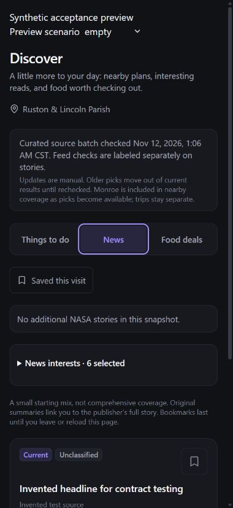

# Discover loader: public-only acceptance

Verified locally on 2026-11-12 following the owner-authorized next task from the
[bundled-loader handoff](DISCOVER_BUNDLED_LOADER.md). Git HEAD remains `8d4a84d`.
Existing uncommitted work is preserved; privacy stays paused. No product source
change was needed, and no live feed/artifact was added to the default catalog.

## Isolated Next production build

The existing public-only fixture imports the actual Discover route and its server
loader/client view. It excludes the authenticated layout, app store, journal, font
downloads and application CSS build pipeline. Next.js **16.4.1**, Cache Components
and Partial Prefetching were enabled, with Webpack and two build workers.

Running the fixture outside the filesystem sandbox, with fresh output at
`build/discover-next-loader-check/.next-loader-permission-check`, passed:

- Webpack compilation and the build's TypeScript phase.
- Page-data collection and generation of all three static pages.
- Optimization and build traces, with exit code 0.
- The route summary lists `/` and `/_not-found`; the generated prerender manifest
  confirms a complete, statically computed response for the real imported Discover
  page. This is not the earlier incomplete fixture that built only a 404.

This closes the **isolated fixture build** gate. The earlier sandboxed `EPERM` was
not reproduced in this approved run, consistent with sandbox restrictions; it does
not establish a general OneDrive or OS permissions diagnosis. No permissions were
weakened, prior output forcibly cleaned or real application `.next` directory used.
**A full authenticated application production build remains unverified.**

## In-app browser acceptance

A separate local-only Vite harness imported the actual `DiscoverScreen`, actual
global styles/Tailwind output and invented public fixtures. It used no real app
store, auth, personal records, selected release artifact or live publisher request.
Its toolbar explicitly said “Synthetic acceptance preview.” Source links were
inspected but not opened.

An initial sandboxed preview run failed trying to replace a shared Vite dependency
cache. The fixture was changed to use its own ignored cache and ran outside the
sandbox with approval, bound only to `127.0.0.1:4322`. The existing shared cache was
not cleaned or overwritten by the successful run.

All five scenarios were checked at each viewport: unavailable, fresh, stale, expired
and valid empty feed. Measured results:

| Viewport width | Available document width | Document scroll width, all five states | Feed notice fits | Tab button heights |
| --- | --- | --- | --- | --- |
| 320 px | 310 px | 310 px | Yes | 56 px |
| 390 px | 380 px | 380 px | Yes | 44 px |

The 10px difference is the browser scrollbar. No horizontal overflow or clipped
status notice was observed. The feed status retained `role=status` and
`aria-live=polite` across scenario changes. This checks markup and browser behavior,
not actual screen-reader announcement quality.

Behavior observed:

- Unavailable feed: fallback notice plus an eligible invented curated story.
- Fresh feed: distinct feed-check/load timestamps, institutional-update label,
  unavailable summary, unknown article access and direct source link.
- Stale feed: no current story recommendation; both stale fixtures appear under
  “Needs a check.” No transport or editorial timestamp changed.
- Saved feed story across expiry: absent from current recommendations but retained
  under “Updates to saved picks,” labeled “Past its listing window” and still saved.
- Valid empty snapshot: “No additional NASA stories in this snapshot,” distinct
  from unavailable data, while eligible curation remains.
- Keyboard Right moved News to Food deals; Home moved to Things to do; End moved
  to Food deals; Left returned to News. Selection and focus stayed together.
  Tab then reached the focusable News panel and the next Tab reached Saved this visit.
  Computed focus outline was solid and visible. Tabs used one selected/tabbable item.
- Browser logs reported no warnings/errors during the checked scenarios.

This is isolated Chromium/in-app-browser evidence, **not Safari, physical iPhone,
Home Screen, authenticated route hydration or complete application acceptance**.
The preview server was stopped (port 4322 verified closed), temporary tab closed
and browser viewport override reset. No native desktop input was used. Generated
fixture/cache/build output remains Git-ignored under `build/`.

## Overview & Roadmap handoff

- **MVP/source recommendation:** curated nearby outings, chain offers with complete
  terms and broader curated news; NASA remains an optional institutional science
  supplement with an empty release selection. No live content or automation enabled.
- **Verified:** isolated Next production build and the 320/390px public-only acceptance
  above. Prior **243-test**, lint and project TypeScript results are historical from
  the loader stage; they were not needlessly rerun for documentation/fixture-only work.
  Whitespace checks passed in this stage.
- **Uncertain:** full-app build, physical iPhone/Safari, actual capture provenance,
  operator/cadence and hosting plan/remaining quotas. The earlier free-service research
  remains conditional; no service/key/account/dependency was added.
- **Affected files:** this report, one synthetic screenshot and Discover handoff links;
  generated public test fixtures only under ignored `build/`. Shared auth/store/journal/
  privacy code and application configuration are untouched. Nothing committed or deployed.
- **Next bounded task:** implement the manual acquisition coordinator described in
  [the concrete capture plan](DISCOVER_CAPTURE_PLAN.md), with injected transport,
  persistent local admission and synthetic crash/write/concurrency tests. Keep app
  selection empty and no automatic publisher request. Actual capture must respect
  known request history; publication remains separately authorized.
